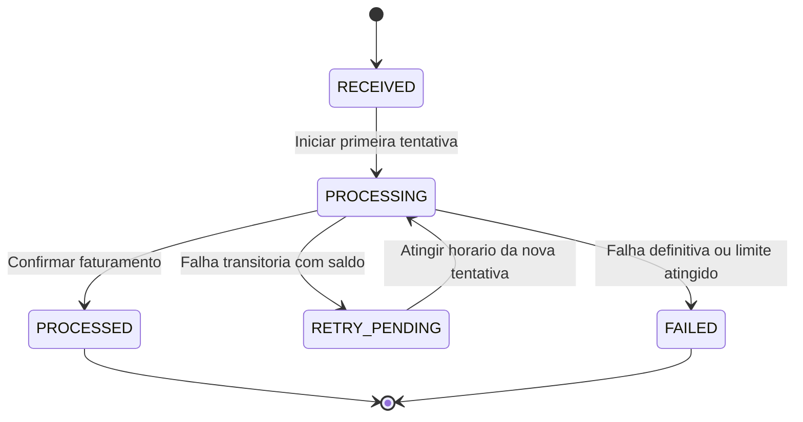
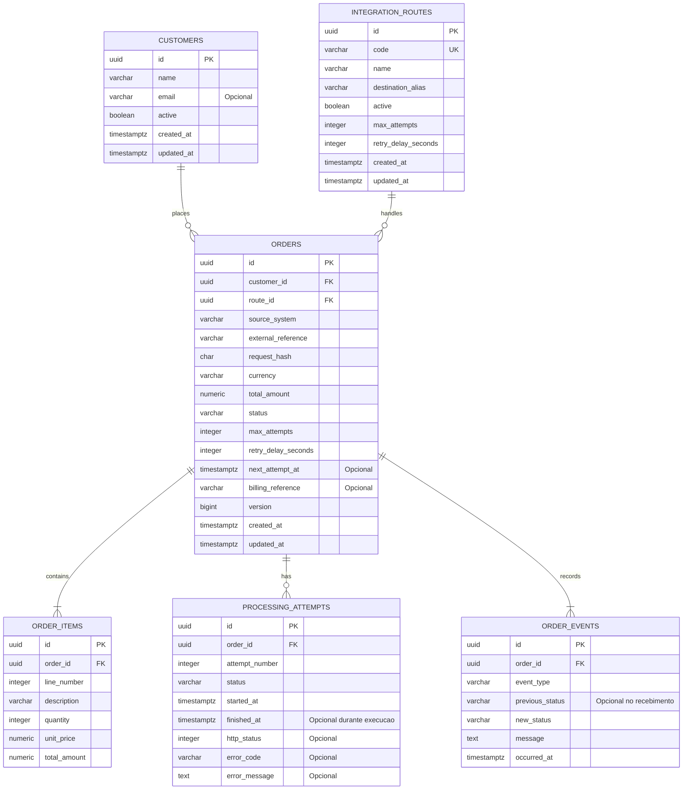

# IntegraFlow

**Plataforma de integração de sistemas com Java, Spring Boot e Apache Camel.**

O IntegraFlow conecta o recebimento de pedidos ao faturamento, organiza o processamento das mensagens e mantém o histórico das integrações. O projeto foi concebido para praticar desenvolvimento backend, integração entre serviços e tratamento de falhas em um cenário de negócio demonstrável.

> **Status: planejamento e documentação inicial.** Este README descreve o comportamento proposto para a primeira versão. A aplicação, os endpoints, as migrações e os testes ainda não foram implementados. O DER representa o modelo de dados planejado.

## Navegação

- [Objetivo](#objetivo)
- [Escopo da primeira versão](#escopo-da-primeira-versão)
- [Arquitetura proposta](#arquitetura-proposta)
- [Tecnologias](#tecnologias)
- [Regras de negócio](#regras-de-negócio)
- [Ciclo de vida do pedido](#ciclo-de-vida-do-pedido)
- [DER — Diagrama de Entidade-Relacionamento](#der--diagrama-de-entidade-relacionamento)
- [Dicionário de dados](#dicionário-de-dados)
- [Restrições e índices](#restrições-e-índices)
- [API planejada](#api-planejada)
- [Qualidade e critérios de aceite](#qualidade-e-critérios-de-aceite)
- [Preparação do ambiente](#preparação-do-ambiente)
- [Roteiro de evolução](#roteiro-de-evolução)
- [Autor](#autor)

## Objetivo

Demonstrar como uma aplicação Java pode receber um pedido, validar seus dados e usar Apache Camel para encaminhá-lo a um serviço de faturamento, preservando informações suficientes para acompanhar o resultado e investigar falhas.

O cenário inicial utiliza um faturamento simulado, sem cobranças reais ou emissão fiscal. O simulador permitirá demonstrar sucesso, indisponibilidade temporária e rejeição de negócio.

## Escopo da primeira versão

- Cadastro e consulta de clientes.
- Recebimento e consulta de pedidos com um ou mais itens.
- Identificação de pedidos duplicados por origem e referência externa.
- Processamento por uma rota Apache Camel previamente definida no código.
- Integração HTTP com um serviço de faturamento simulado.
- Persistência dos pedidos, das tentativas e do histórico de eventos.
- Novas tentativas para falhas transitórias, respeitando o limite configurado.
- Consultas de pedidos, rotas e resultados de processamento.
- Indicadores de quantidade de pedidos por status.

O backend será organizado como uma aplicação modular. A primeira versão terá uma rota de faturamento e uma moeda, BRL. Kafka, autenticação, múltiplos destinos, edição visual de rotas e reprocessamento manual pertencem às evoluções posteriores.

## Arquitetura proposta

| Parte | Responsabilidade |
| --- | --- |
| API REST | Receber solicitações, validar o contrato e disponibilizar consultas. |
| Camada de aplicação | Aplicar as regras de negócio e controlar as transições de status. |
| PostgreSQL | Persistir pedidos, itens, políticas de tentativa e eventos de processamento. |
| Processador de pedidos | Selecionar pedidos disponíveis e coordenar sua execução com exclusão concorrente. |
| Apache Camel | Executar a rota, transformar a mensagem e chamar o faturamento. |
| Faturamento simulado | Produzir resultados controlados para demonstrar integrações e falhas. |

**Fluxo proposto:** a API grava o pedido e seu evento de recebimento na mesma transação. Um processador interno busca os pedidos pendentes, registra cada tentativa e aciona o Camel. O resultado atualiza o pedido e gera novos eventos.

A chamada HTTP ao faturamento ocorre fora de uma transação longa de banco de dados. A seleção do trabalho e a gravação dos resultados utilizam transações curtas. A implementação deverá definir o bloqueio dos pedidos, a recuperação de execuções interrompidas e a prevenção de processamento concorrente.

O banco será a fonte dos pedidos pendentes; uma fila apenas em memória não será suficiente para preservar trabalho após uma reinicialização. A entrega ao faturamento será projetada para admitir repetição, usando uma chave estável no destino. O projeto não pressupõe garantia de entrega única entre banco e HTTP.

## Tecnologias

| Tecnologia | Uso planejado |
| --- | --- |
| Java 21 | Linguagem do backend. |
| Spring Boot | Aplicação, configuração e API REST. |
| Apache Camel | Rotas e integração com o faturamento. |
| Spring Data JPA / Hibernate | Persistência e consultas. |
| Jakarta Bean Validation | Validação dos contratos de entrada. |
| PostgreSQL | Banco de dados relacional. |
| Flyway | Versionamento das alterações de banco. |
| Maven Wrapper | Build reproduzível do backend. |
| Docker Compose | Ambiente local da aplicação e suas dependências. |
| JUnit e ferramentas de teste de integração | Verificação das regras e dos fluxos de integração. |
| React e TypeScript | Painel web em uma etapa posterior. |
| Apache Kafka | Entrada de eventos em uma etapa posterior. |

As versões de Spring Boot, Camel e suas dependências serão fixadas após verificar a compatibilidade entre elas. A tabela expressa decisões de projeto, não dependências já instaladas.

## Regras de negócio

As regras abaixo são a especificação proposta para o MVP.

| Código | Regra | Comportamento esperado |
| --- | --- | --- |
| RN-01 | Cliente válido | Todo pedido deve referenciar um cliente existente e ativo no momento do recebimento. |
| RN-02 | Rota disponível | Novos pedidos somente podem ser aceitos para uma rota cadastrada e ativa. No MVP, a rota é escolhida pelo servidor. |
| RN-03 | Identificação na origem | O pedido deve informar `sourceSystem` e `externalReference`, ambos não vazios. |
| RN-04 | Prevenção de duplicidade | A combinação de rota, sistema de origem e referência externa identifica um pedido de forma única. Repetir a mesma solicitação não cria outro pedido. |
| RN-05 | Conflito de conteúdo | A repetição da identificação com conteúdo de negócio diferente retorna conflito, sem alterar o pedido original. O servidor compara o hash de uma representação canônica do conteúdo. |
| RN-06 | Itens obrigatórios | Todo pedido aceito possui pelo menos um item; cada item deve ter descrição não vazia, quantidade inteira positiva e preço unitário maior ou igual a zero. |
| RN-07 | Cálculo de valores | O servidor calcula o total de cada item e do pedido usando valores decimais. O total do pedido deve ser positivo; o valor total enviado pelo consumidor não é uma fonte confiável de cálculo. |
| RN-08 | Moeda e precisão | A primeira versão aceita apenas BRL, com até duas casas decimais para preços. Descontos, frete e tributos não compõem o cálculo inicial. |
| RN-09 | Imutabilidade | Cliente, origem, referência e itens de um pedido aceito não podem ser alterados. Uma correção de conteúdo exige uma nova referência externa. |
| RN-10 | Estado inicial | Um pedido aceito começa em `RECEIVED`. Pedidos inválidos são rejeitados antes de sua criação. |
| RN-11 | Execução exclusiva | Um mesmo pedido não pode ter duas tentativas em execução simultaneamente. A proteção deve funcionar também com mais de uma instância da aplicação. |
| RN-12 | Política de tentativas | O limite inicial é de três tentativas totais: uma inicial e até duas adicionais. O intervalo padrão é de 30 segundos entre o fim da tentativa malsucedida e a próxima execução elegível. A política é copiada para o pedido na criação. |
| RN-13 | Falhas transitórias | Timeout, falha de conexão e respostas HTTP 429 ou 5xx permitem nova tentativa enquanto existir saldo. Um `Retry-After` válido poderá ampliar o intervalo mínimo. |
| RN-14 | Falhas definitivas | Rejeição de negócio, resposta incompatível com o contrato e respostas HTTP 4xx diferentes de 429 encerram o processamento em `FAILED`, sem repetição automática. |
| RN-15 | Resultado confirmado | O pedido somente passa a `PROCESSED` após uma resposta de sucesso válida do faturamento, com sua referência registrada. Um HTTP 2xx isolado não comprova um resultado válido. |
| RN-16 | Esgotamento | Uma falha transitória na última tentativa leva o pedido a `FAILED`, com motivo registrado. |
| RN-17 | Histórico | Cada mudança de status gera um evento com o status anterior, o novo status, a data e o motivo. Cada tentativa possui número, início e resultado próprios. |
| RN-18 | Idempotência no destino | Todas as tentativas enviam a mesma chave de integração, derivada do UUID do pedido. O faturamento simulado deve reconhecer essa chave e evitar duplicação do resultado. |
| RN-19 | Desativação de rota | Desativar uma rota impede novos pedidos e novas execuções. Uma tentativa já iniciada pode concluir; pedidos pendentes ficam preservados para a reativação. |
| RN-20 | Preservação do histórico | Clientes e rotas referenciados não são removidos fisicamente no MVP. Pedidos, itens, tentativas e eventos não possuem exclusão pela API. |

### Detalhes da prevenção de duplicidade

- A rota é resolvida pelo servidor antes da verificação de duplicidade.
- O sistema remove espaços nas extremidades dos identificadores; a comparação dos identificadores permanece sensível a maiúsculas e minúsculas.
- O hash considera cliente, moeda e itens, além dos identificadores de origem. Preços são normalizados para duas casas; a sequência dos itens faz parte do conteúdo.
- Para uma repetição idêntica, a API retorna o pedido existente e não agenda outra execução. Essa consulta continua possível se o cliente ou a rota tiver sido desativado depois da criação.
- A restrição de unicidade no banco deve proteger também solicitações simultâneas. Uma verificação somente em memória não atende à regra.

### Política de repetição

O controle do número de tentativas será persistido pela aplicação. Repetições internas adicionais do Camel deverão ser desativadas no fluxo de faturamento, para que uma tentativa registrada represente no máximo uma chamada HTTP de negócio.

Uma interrupção pode ocorrer depois de o faturamento aceitar a solicitação e antes de o resultado ser salvo localmente. A recuperação deverá reconciliar ou repetir a operação com a mesma chave de integração, respeitando o limite total. O timeout de execução e o procedimento de recuperação de tentativas interrompidas precisam ser definidos e testados na implementação.

## Ciclo de vida do pedido

| Status | Significado |
| --- | --- |
| `RECEIVED` | Pedido persistido e aguardando processamento. |
| `PROCESSING` | Uma tentativa está em andamento. |
| `RETRY_PENDING` | Uma falha transitória permite nova tentativa após o horário registrado. |
| `PROCESSED` | Faturamento concluído com resultado válido. |
| `FAILED` | Falha definitiva ou limite total de tentativas atingido. |



Pedidos em `PROCESSED` ou `FAILED` não retornam automaticamente ao processamento. Reprocessamento manual, cancelamento e novos ciclos de tentativa serão especificados em uma versão posterior.

## DER — Diagrama de Entidade-Relacionamento

O modelo abaixo contém seis entidades. Os nomes físicos propostos estão em inglês para manter consistência com o código. O DER será convertido em migrações Flyway durante a implementação.



### Cardinalidades

| Relacionamento | Cardinalidade | Interpretação |
| --- | --- | --- |
| Cliente → Pedido | 1 : 0..N | Um cliente pode não ter pedidos ou possuir vários; cada pedido pertence a um cliente. |
| Rota → Pedido | 1 : 0..N | Uma rota pode atender vários pedidos; cada pedido utiliza uma rota. |
| Pedido → Item | 1 : 1..N | Um pedido aceito contém pelo menos um item; cada item pertence a um pedido. |
| Pedido → Tentativa | 1 : 0..N | Um pedido pode aguardar sua primeira execução; cada tentativa pertence a um pedido. |
| Pedido → Evento | 1 : 1..N | Todo pedido possui pelo menos o evento de recebimento; cada evento pertence a um pedido. |

As cardinalidades mínimas de itens e eventos dependem da criação transacional do agregado e das validações da aplicação; uma chave estrangeira isolada não garante a existência desses registros.

## Dicionário de dados

| Entidade | Finalidade | Campos e decisões principais |
| --- | --- | --- |
| `customers` | Identificar o cliente do pedido. | Nome obrigatório, e-mail opcional e indicador de ativação. O e-mail não é a identidade do cliente. |
| `integration_routes` | Registrar a rota disponível e sua política padrão. | `code` único e estável; `destination_alias` identifica um destino configurado na aplicação. Não contém credenciais nem permite executar código vindo do banco. |
| `orders` | Representar o pedido e seu estado atual. | Identificação de origem, hash do conteúdo, total, política copiada da rota, horário da próxima tentativa e referência do faturamento. |
| `order_items` | Registrar o conteúdo comercial do pedido. | Posição do item, descrição, quantidade, preço unitário e total calculado. Não depende de um catálogo de produtos. |
| `processing_attempts` | Registrar cada execução do pedido. | Número sequencial e status `RUNNING`, `SUCCEEDED` ou `FAILED`; término e resultado ficam disponíveis ao encerrar a tentativa. |
| `order_events` | Preservar as mudanças de estado do pedido. | Tipo do evento, status anterior e novo, mensagem e data. O recebimento usa status anterior nulo. |

### Convenções de armazenamento

- Chaves primárias do tipo UUID, geradas no servidor.
- Valores monetários do tipo `numeric(19,2)` no PostgreSQL e `BigDecimal` no Java.
- `currency` com três caracteres, restrita a `BRL` no MVP.
- `request_hash` com 64 caracteres, para o SHA-256 do conteúdo canônico.
- Datas do tipo `timestamptz`, trocadas pela API em ISO 8601 com fuso horário.
- `version` para controle de concorrência otimista; o mecanismo de seleção exclusiva do trabalho também deverá ser implementado.
- Campos obrigatórios com `NOT NULL`; somente os campos explicitamente opcionais no DER aceitam nulo.
- Mensagens de erro devem ser sanitizadas. Credenciais, tokens e dados completos de respostas externas não devem ser gravados no histórico.

## Restrições e índices

| Tipo | Definição planejada | Finalidade |
| --- | --- | --- |
| `UNIQUE` | `integration_routes(code)` | Evitar cadastro duplicado de uma rota. |
| `UNIQUE` | `orders(route_id, source_system, external_reference)` | Impedir pedidos duplicados na mesma origem e rota. |
| `UNIQUE` | `order_items(order_id, line_number)` | Preservar a posição única de cada item do pedido. |
| `UNIQUE` | `processing_attempts(order_id, attempt_number)` | Evitar repetição do número de uma tentativa. |
| Índice único parcial | `processing_attempts(order_id)` quando `status = 'RUNNING'` | Impedir duas tentativas simultâneas para um pedido. |
| `CHECK` | Quantidade e posição do item positivas; preço unitário não negativo; total do item igual a quantidade × preço | Proteger os valores dos itens. |
| `CHECK` | Total do pedido positivo; moeda BRL; status pertencente ao conjunto definido | Proteger o estado básico do pedido. |
| `CHECK` | Limite de tentativas entre 1 e 3; intervalo positivo; número de tentativa entre 1 e 3 | Proteger os limites da primeira versão. |
| `CHECK` | Tentativa em execução sem término; tentativa concluída com término maior ou igual ao início | Manter consistência temporal das execuções. |
| `FK` com exclusão restrita | Pedido → cliente/rota; item/tentativa/evento → pedido | Preservar a integridade dos relacionamentos. |
| Índice | `orders(status, next_attempt_at, created_at)` | Apoiar a seleção de pedidos disponíveis. |
| Índice | `orders(customer_id, created_at)` e `orders(route_id, created_at)` | Apoiar consultas por cliente e rota. |
| Índice | `order_events(order_id, occurred_at)` | Apoiar a consulta cronológica do histórico. |

A igualdade entre o total do pedido e a soma dos itens, a sequência de tentativas, o limite copiado no pedido e as transições de estado também dependem de validação transacional da aplicação. Os `CHECKs` de uma tabela não verificam, sozinhos, agregações e regras entre tabelas.

## API planejada

**Os endpoints abaixo são contratos propostos e ainda não estão disponíveis.**

| Método | Endpoint | Finalidade |
| --- | --- | --- |
| `POST` | `/api/v1/customers` | Cadastrar um cliente. |
| `GET` | `/api/v1/customers` | Listar clientes com paginação. |
| `GET` | `/api/v1/customers/{id}` | Consultar um cliente. |
| `PATCH` | `/api/v1/customers/{id}/status` | Ativar ou desativar um cliente. |
| `POST` | `/api/v1/orders` | Receber um pedido para processamento. |
| `GET` | `/api/v1/orders` | Listar pedidos com paginação e filtros por status e cliente. |
| `GET` | `/api/v1/orders/{id}` | Consultar um pedido e seus itens. |
| `GET` | `/api/v1/orders/{id}/attempts` | Consultar as tentativas de processamento. |
| `GET` | `/api/v1/orders/{id}/events` | Consultar o histórico do pedido. |
| `GET` | `/api/v1/integration-routes` | Consultar as rotas cadastradas. |
| `PATCH` | `/api/v1/integration-routes/{id}/status` | Ativar ou desativar uma rota. |
| `GET` | `/api/v1/dashboard/summary` | Consultar quantidades de pedidos por status. |

A rota inicial será criada por migração ou configuração controlada. O MVP não oferecerá cadastro de rotas arbitrárias pela API. As consultas de coleções usarão paginação.

### Exemplo de solicitação de pedido

O exemplo pressupõe um cliente já cadastrado. O UUID e o conteúdo são ilustrativos.

```json
{
  "customerId": "6f8ecde7-63c8-4aeb-b942-265375b10a12",
  "sourceSystem": "LOJA_DEMO",
  "externalReference": "PED-2026-0001",
  "currency": "BRL",
  "items": [
    {
      "description": "Teclado USB",
      "quantity": 2,
      "unitPrice": 89.90
    },
    {
      "description": "Mouse USB",
      "quantity": 1,
      "unitPrice": 49.90
    }
  ]
}
```

O total calculado para esse pedido será **R$ 229,70**. O servidor atribuirá as posições dos itens conforme a sequência recebida.

| Situação | Resposta HTTP planejada |
| --- | --- |
| Pedido novo aceito | `202 Accepted`, com identificador, status e endereço de consulta. |
| Repetição idêntica | `200 OK`, com o pedido existente e seu status atual. |
| Identificação repetida com conteúdo diferente | `409 Conflict`. |
| Corpo inválido, campos ausentes ou itens inválidos | `400 Bad Request`. |
| Cliente inexistente | `404 Not Found`. |
| Cliente inativo ou rota indisponível para novo pedido | `409 Conflict`. |

## Qualidade e critérios de aceite

Os itens abaixo orientarão os testes; não representam testes já executados.

- [ ] Um pedido válido é persistido com itens e evento inicial na mesma transação.
- [ ] Quantidade inválida, preço negativo, moeda diferente de BRL e total zero são rejeitados.
- [ ] O total é calculado no servidor sem uso de ponto flutuante binário para valores monetários.
- [ ] Uma solicitação duplicada idêntica retorna o mesmo pedido, inclusive sob concorrência.
- [ ] Uma solicitação duplicada com conteúdo diferente retorna conflito.
- [ ] A rota Camel encaminha a mensagem no formato esperado pelo faturamento simulado.
- [ ] Uma resposta válida de sucesso conclui o pedido e registra a referência do faturamento.
- [ ] Uma falha transitória agenda nova tentativa e respeita o limite de três chamadas totais.
- [ ] Uma rejeição definitiva encerra o processamento sem repetição automática.
- [ ] Dois processadores concorrentes não executam o mesmo pedido simultaneamente.
- [ ] Uma reinicialização preserva pedidos pendentes e permite recuperar execuções interrompidas.
- [ ] Repetir a chamada ao simulador com a mesma chave não duplica o faturamento.
- [ ] Uma rota desativada impede novas execuções e preserva os pedidos pendentes.
- [ ] O histórico permite reconstruir as transições de estado e os resultados de cada tentativa.
- [ ] As migrações e os testes de persistência funcionam com PostgreSQL.

## Preparação do ambiente

Pré-requisitos planejados: Git, JDK 21, Docker com Compose e uma IDE Java, como IntelliJ IDEA. O Maven Wrapper será adicionado junto ao backend.

```powershell
git clone https://github.com/juceliocoelho2022/integraflow.git
cd integraflow
java -version
docker --version
docker compose version
```

Neste momento, esses comandos preparam e verificam o ambiente. Os comandos de build, execução e testes serão acrescentados quando os respectivos arquivos existirem no repositório.

O MVP foi pensado para execução local. A disponibilização pública de endpoints administrativos depende da implementação dos controles de autenticação e autorização previstos na evolução do projeto.

## Roteiro de evolução

| Etapa | Entregas previstas | Situação |
| --- | --- | --- |
| Documentação inicial | Proposta, regras de negócio e DER. | Documentada neste README. |
| v0.1 — Backend de integração | API, PostgreSQL, migrações, rota Camel, faturamento simulado, tentativas e testes. | Planejada. |
| v0.2 — Painel web | Dashboard, consulta de pedidos, tentativas, eventos e status das rotas em React/TypeScript. | Planejada. |
| v0.3 — Eventos | Entrada de pedidos por Kafka e políticas específicas para consumo de mensagens. | Planejada. |
| v0.4 — Operação | Autenticação, autorização, métricas, rastreamento e reprocessamento manual auditado. | Planejada. |

O reprocessamento manual exigirá definir novos ciclos de tentativas e sua auditoria; não deverá simplesmente apagar o histórico ou reiniciar contadores existentes.

## Autor

**Jucelio Farias Coelho**  
Desenvolvimento Backend Java · Integração de Sistemas · Dados · Qualidade de Software

- [Perfil no GitHub](https://github.com/juceliocoelho2022)
- [Repositório IntegraFlow](https://github.com/juceliocoelho2022/integraflow)

## Licença

Uma licença de uso ainda não foi definida. Este README não concede uma licença de software; as condições serão formalizadas em um arquivo `LICENSE` quando escolhidas pelo autor.
